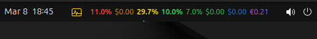

> [!CAUTION]
> ### 🚨 STRICTLY EXPERIMENTAL — PROOF OF CONCEPT (PRE-ALPHA)
>
>    
>
> **PLEASE READ CAREFULLY BEFORE USING THIS SOFTWARE:**
>
> * **Very Early Stage:** This project is currently a raw **Proof of Concept (PoC)** in a **pre-alpha** state. It is nowhere near production-ready and may contain severe bugs, breaking changes, or incomplete logic.
> * **Personal Use Only:** This repository is developed, maintained, and shared strictly for **personal use**.
> * **No Support or Feature Requests:** Please **do not** open issues, bug reports, or feature requests. They will not be addressed or accepted at this stage of development.
> * **No Warranty:** This software is provided **"AS IS"**, without warranty of any kind, express or implied. You may use it strictly for **testing and evaluation purposes** at your own sole risk.

# AIBar / aibar (0.58.0)

<p align="center">
  
  
  
  

</p>

<p align="center">
<strong>Monitor AI usage and quota in one CLI.</strong><br>
AIBar aggregates usage metrics for Antigravity (agy), OpenAI, OpenRouter, GitHub Copilot, Codex, GeminiAI, and Z.ai, with colored terminal panels and a GNOME Shell panel extension.
It caches provider results locally, gates refreshes with idle-time windows, throttles provider API calls, and exposes both human-readable text output and a stable machine-readable JSON contract.
</p>

<p align="center">
  <a href="#feature-highlights">Feature Highlights</a> |
  <a href="#quick-start">Quick Start</a> |
  <a href="#users-guide">User's Guide</a> |
  <a href="#acknowledgments">Acknowledgments</a>
</p>

<p align="center">
<br>
🚧 <strong>DRAFT:</strong> Proof-of-Concept (PoC) Version 📝 - Work in Progress 🏗️ 🚧<br>
⚠️ <strong>IMPORTANT NOTICE</strong>: Created with <a href="https://www.npmjs.com/package/pi-usereq"><strong>PI-useReq/pi-usereq</strong></a> 🤖✨ ⚠️<br>
<br>
</p>

# Feature Highlights

AIBar brings every supported AI provider quota and cost into one place, on the terminal and in the GNOME panel.

- Unified `show` command for multiple providers (`agy`, `openai`, `openrouter`, `copilot`, `codex`, `geminiai`, `zai`).
- Text output and machine output (`show --json`) with stable top-level sections (`payload`, `status`, `idle_time`, `freshness`, `extension`, `enabled_providers`).
- Per-run refresh override with `show --force` (bypasses idle-time gating for that execution).
- Interactive `setup` for provider enable/disable state, runtime throttling, Copilot overage pricing, provider currency symbols, GeminiAI OAuth/project settings, and logging flags.
- Built-in lifecycle and observability flags: `--version|--ver`, `--upgrade`, `--upgrade --develop|--dev`, `--uninstall`, `--enable-log`, `--disable-log`, `--enable-debug`, `--disable-debug`.
- Startup release preflight that can emit update notices or fetch diagnostics before normal command output.
- GNOME Shell extension support via `gnome-install` / `gnome-uninstall`, popup `Refresh Now`, and JSON-driven refresh/window metadata.

# Quick Start

Bring-up follows three steps: install, configure, run. AIBar is published on
[PyPI](https://pypi.org/project/aibar/). The primary installation method is
`pipx`; execution and live runs use [Astral uv](https://docs.astral.sh/uv/).

```bash
# 1) Primary installation via pipx
sudo apt install pipx
pipx ensurepath
pipx install aibar

# 2) Alternative installation from PyPI (requires Python >= 3.12 and uv)
uv tool install aibar

# 2) Configure credentials and runtime settings
aibar setup

# 3) Verify provider configuration and connectivity
aibar doctor

# 4) Show usage
aibar show
aibar show --json
```

To place usage in the GNOME top panel, run `aibar gnome-install` and enable the
*AIBar Monitor* extension. All optional configuration (GitHub installs, provider
credentials details, throttling, currencies, logging, JSON contract) is covered
in the [User's Guide](#users-guide).

# Requirements

- Python >= 3.12; the repository pins the interpreter via `.python-version` and `uv run` resolves a Python 3.12+ interpreter automatically.
- [Astral uv](https://docs.astral.sh/uv/): `uv` for installation/removal and `uvx` for live execution; no external virtualenv bootstrap is required.
- Published package on [PyPI](https://pypi.org/project/aibar/) (project `aibar`) as the default distribution source.
- Network access to `pypi.org` and `api.github.com` for startup update checks and `--version` reporting, plus each provider's API endpoint.
- Linux for the lifecycle flags `--upgrade` and `--uninstall` (on non-Linux platforms AIBar prints the equivalent manual `uv` command).
- GNOME Shell `45`, `46`, `47`, or `48` with the `gnome-extensions` CLI, for the panel extension.
- Provider-specific prerequisites:

| Provider | Prerequisite |
|---|---|
| `agy` (Antigravity) | Local `agy` CLI available on `PATH` (no API key required) |
| `openai` | `OPENAI_ADMIN_KEY` (organization admin API key) |
| `openrouter` | `OPENROUTER_API_KEY` |
| `copilot` | GitHub account for the device-flow login (`aibar login --provider copilot`) |
| `codex` | Existing Codex login read from `~/.codex/auth.json` |
| `geminiai` | Google Cloud project with Desktop OAuth 2.0 client, Cloud Monitoring API, BigQuery API, and a billing export dataset (details in the User's Guide) |
| `zai` | `ZAI_API_KEY` |

# User's Guide

## Installation

AIBar is published on [PyPI](https://pypi.org/project/aibar/) as `aibar`.
PyPI is the default source used by the program for version checks and self-upgrades (`aibar --upgrade`).
Intermediate and test releases are available on [GitHub](https://github.com/Ogekuri/AIBar).

### Install from PyPI with uv

Install AIBar as an isolated `uv` tool:

```bash
uv tool install aibar
```

After installation the `aibar` command is available system-wide:

```bash
aibar --help
aibar setup
aibar show
```

### Alternative installation with pip

Install AIBar with `pip` as an alternative to the primary `pipx` flow:

```bash
pip install aibar
```

### Live execution without installation

Run AIBar directly with `uvx`, without installing anything:

```bash
uvx aibar --help
uvx aibar show --json
```

### Install from GitHub (alternative: intermediate and test releases)

Stable releases are distributed through PyPI. Intermediate and test releases
are published on [GitHub](https://github.com/Ogekuri/AIBar).

Install the latest GitHub version with uv:

```bash
uv tool install --force git+https://github.com/Ogekuri/AIBar
```

Upgrade an existing installation to the latest GitHub release:

```bash
aibar --upgrade --develop
```

`aibar --upgrade --develop` and `aibar --upgrade --dev` are equivalent.

`aibar --version` reports the installed version plus the latest release
available on both PyPI and GitHub.

### Live Execution from GitHub (no install)

Run AIBar directly from the repository without a local clone using `uvx`:

```bash
uvx --from "git+https://github.com/Ogekuri/AIBar.git" aibar --help
uvx --from "git+https://github.com/Ogekuri/AIBar.git" aibar show --json
uvx --from "git+https://github.com/Ogekuri/AIBar.git" aibar doctor
```

### Export requirements.txt (optional)

```bash
uv export --format requirements-txt > requirements.txt
```

## Configuration

### Credentials

Credentials resolve in this order: environment variable, then
`~/.config/aibar/env`, then provider-specific local credential stores.

| Provider | Credential source |
|---|---|
| `agy` (Antigravity) | Local `agy` CLI available on `PATH` (no API key required) |
| `openai` | `OPENAI_ADMIN_KEY` (organization admin API key) |
| `openrouter` | `OPENROUTER_API_KEY` |
| `copilot` | `aibar login --provider copilot` (saves token to `~/.config/aibar/copilot.json`) |
| `codex` | Existing Codex login read from `~/.codex/auth.json` |
| `geminiai` | Google OAuth configured during `aibar setup` or `aibar login --provider geminiai` |
| `zai` | `ZAI_API_KEY` |

API keys entered during `aibar setup` are stored in `~/.config/aibar/env`.

### Setup persistence and config schema

`aibar setup` writes:
- `~/.config/aibar/env`: credentials entered during setup.
- `~/.config/aibar/config.json`: runtime settings.

User-editable `config.json` keys surfaced by setup:
- `idle_delay_seconds` (default `300`)
- `api_call_delay_milliseconds` (default `100`)
- `api_call_timeout_milliseconds` (default `5000`)
- `default_retry_after_seconds` (default `3600`)
- `gnome_refresh_interval_seconds` (default `60`)
- `billing_data` (default `billing_data`)
- `enabled_providers` (missing provider keys default to enabled)
- `copilot_extra_premium_request_cost` (default `0.04`)
- `currency_symbols` (per-provider display symbol; setup choices `$`, `£`, `€`, default `$`)
- `log_enabled`
- `debug_enabled`
- `geminiai_project_id`

### Provider login

```bash
# Copilot GitHub device-flow login
aibar login --provider copilot

# GeminiAI Google OAuth browser login (requires the OAuth client configured in setup)
aibar login --provider geminiai

# Re-authenticate only providers currently in cached FAIL state
aibar login
```

### GeminiAI prerequisites

To enable GeminiAI features, configure Google Cloud before running `aibar setup`:

1. Create **Desktop Client OAuth 2.0** credentials in the target Google Cloud project.
2. In `aibar setup`, configure GeminiAI OAuth client JSON (`file` or `paste`) or re-authorize with `login`, then authorize requested scopes:
   - `https://www.googleapis.com/auth/bigquery.readonly`
   - `https://www.googleapis.com/auth/monitoring.read`
   - `https://www.googleapis.com/auth/cloud-platform`
3. Configure the Gemini project id in setup (`geminiai project id`) or via `GEMINIAI_PROJECT_ID`.
4. Set setup field `billing_data` to the BigQuery dataset containing billing export tables (`gcp_billing_export_v1_*`, default dataset name: `billing_data`).
5. Ensure required Google APIs are enabled for the project used by OAuth credentials:
   - Cloud Monitoring API
   - BigQuery API

## Running the CLI

### Core commands

```bash
# Show all configured providers
# (default flow renders dual windows for codex when --window is not set)
aibar show

# Provider selection
# allowed values: agy, openai, openrouter, copilot, codex, geminiai, zai, all
aibar show --provider codex --window 5h

# JSON output for scripts/integrations
aibar show --json

# Force refresh for current execution (ignore idle-time gate)
aibar show --force

# Diagnostics and configuration
aibar doctor
aibar env
aibar setup

# GNOME extension lifecycle
aibar gnome-install
aibar gnome-uninstall
```

Providers disabled during `aibar setup` (stored under `enabled_providers`) are skipped by refresh/idle-time handling and omitted from `show` text and `show --json` output.

### Global lifecycle and logging options

```bash
# Version
# aibar --version and aibar --ver are equivalent
aibar --version

# Package lifecycle helpers (Linux: executed directly; non-Linux: prints manual command)
aibar --upgrade
# aibar --upgrade --develop and aibar --upgrade --dev are equivalent
aibar --upgrade --develop
aibar --uninstall

# Runtime logging flags
# execution log path: ~/.cache/aibar/aibar.log
aibar --enable-log
aibar --disable-log
aibar --enable-debug
aibar --disable-debug
```

- Startup behavior: every CLI invocation runs a latest-release preflight (PyPI) before command parsing. Notices and fetch diagnostics are idle-cached for about `300` seconds; `aibar --version` and `aibar --ver` still force one online check.
- `--version`/`--ver` print the installed version and the latest releases available on PyPI and GitHub.
- `--upgrade` upgrades from PyPI; `--upgrade --develop` (or `--dev`) upgrades from the latest GitHub release instead. Both execute only on Linux; on non-Linux platforms, AIBar prints the equivalent manual `uv` command.
- `--uninstall` executes only on Linux. On non-Linux platforms, AIBar prints the equivalent manual `uv` command.
- Debug rows are emitted only when execution logging is enabled. For verbose API diagnostics, enable both `--enable-log` and `--enable-debug`.

### `show` window behavior

- Allowed windows: `5h`, `7d`, `30d`.
- `codex` supports dual-window rendering (`5h` and `7d`) in default text output when `--window` is not explicitly set.
- For `agy`, `copilot`, `openrouter`, `openai`, `geminiai`, and `zai`, the effective window is fixed to `30d` even if another `--window` is provided.

### Text output layout

- Each provider renders one colored panel in the canonical order `agy`, `openrouter`, `copilot`, `codex`, `openai`, `geminiai`, `zai`; all panels share the same width.
- `Status` is the first line on successful panels, and every panel ends with a right-aligned `Updated: <datetime>, Next: <datetime>` freshness line.
- Usage rows use `Usage: <window> <progress_bar> <percent>%` for `agy`, `openrouter`, `copilot`, `codex`, and `zai`; `openai` and `geminiai` render `Usage: <window> <percent>%` without a bar.
- `Remaining credits: <remaining> / <limit>` is printed for `codex` and `copilot` when the status is `OK`.
- Percentages above 100% render the over-limit segment with the 100% boundary marker.
- Failed providers render `Status: FAIL`, the failure `Reason:`, and the `Updated/Next` freshness line instead of usage statistics.

### Antigravity (agy)

- Provider key `agy`; reads quota data from the local Antigravity CLI (`agy -p /usage`), so the `agy` executable must be installed and available on `PATH`.
- One CLI call returns all quotas; the effective window is fixed to `30d`.
- Text output renders one progress bar per quota with the labels `G 7d`, `G 5h`, `CG 7d`, `CG 5h`, and `A 7d`.
- No monetary metrics are exposed: `agy` renders no cost rows and is excluded from setup currency-symbol prompts.
- In the GNOME extension and CLI panels, `agy` renders as the first provider (red accent), and the panel status bar shows the `G 5h` quota percentage followed by the `G 7d` quota percentage.

### OpenRouter

- The OpenRouter usage view is driven by the **API key credit total** returned by OpenRouter: `100%` on the progress bar corresponds to the total credits on the key (current spend + remaining credit), and the bar shows current spend relative to that total.
- No monthly budget needs to be configured. Spending beyond purchased credits renders the over-credit bar (`>100%`) with the same over-limit marker used by other quota providers.
- `aibar setup` does not prompt for an OpenRouter budget, and no budget key is stored in `config.json`.
- CLI and GNOME views also render `Total cost: <currency_symbol><total_cost>` from the all-time API usage reported for the key (exposed as `metrics.total_cost` in `show --json`).
- `Requests` and `Tokens` rows are not rendered for OpenRouter: the key API exposes no per-key request/token counters.

### Z.ai

- Provider key `zai`; the API key is read from `ZAI_API_KEY` (environment variable or `~/.config/aibar/env`) and can be entered during `aibar setup`.
- One quota request returns all quotas; the effective window is fixed to `30d`.
- Text output renders one progress bar per quota with the short labels `5h`, `1w`, and `1m` (5-hour quota, weekly quota, and total monthly Web Search/Reader quota), each followed by its own `Resets in: <duration>` countdown.
- Usage above 100% on any quota renders the shared over-limit bar segment with the 100% boundary marker.
- In the GNOME extension, Z.ai renders as the last provider tab/card (cyan accent): one progress bar per quota with `Reset in: <duration>`, and the panel status bar shows the `5h` quota percentage followed by the bold `1w` quota percentage.

## GNOME Shell extension

Install, update, or remove the panel extension with the dedicated commands:

```bash
aibar gnome-install      # install or update, then enable aibar@aibar.panel
aibar gnome-uninstall    # disable the extension and remove its files
```

- Installed path: `~/.local/share/gnome-shell/extensions/aibar@aibar.panel/`.
- Supported GNOME Shell versions: `45`, `46`, `47`, `48`.
- Scheduled refreshes run `aibar show --json`.
- Popup `Refresh Now` runs `aibar show --json --force`.
- Disabled providers from `aibar setup` are hidden from panel labels, tabs, and cards.
- Provider cards show `Updated: ..., Next: ...` freshness labels.
- Auto-refresh interval follows `gnome_refresh_interval_seconds` from `aibar setup` / `config.json`.

## Uninstall

```bash
uv tool uninstall aibar
```

Equivalent self-removal (Linux only; also clears cached runtime data
under `~/.cache/aibar/`):

```bash
aibar --uninstall
```

## Repository helper scripts

```bash
# Repository launcher (delegates to uv run --project ... python -m aibar.cli)
scripts/aibar.sh --help

# GNOME nested-shell test helper
# runs gnome-install, then starts a nested Wayland GNOME Shell (1280x720)
scripts/test-gnome-extension.sh
```

# Documentation

## Architecture overview

- `aibar` runs as a single CLI process exposing the subcommands `show`, `doctor`, `env`, `setup`, `login`, `gnome-install`, and `gnome-uninstall`.
- The GNOME extension (`aibar@aibar.panel`) runs inside the GNOME Shell process and spawns `aibar show --json` as a subprocess (and `aibar show --json --force` for popup `Refresh Now`), injecting variables from `~/.config/aibar/env` into the child environment.
- The extension parses the JSON output sections `payload`, `status`, `freshness`, `extension`, and `enabled_providers` to render provider tabs, cards, and panel status labels; the auto-refresh interval is read from `extension.gnome_refresh_interval_seconds`.
- The extension resolves the `aibar` executable from `PATH`, with an `AIBAR_PATH` override accepted in `~/.config/aibar/env`.

## Runtime data layout

| Path | Purpose |
|---|---|
| `~/.config/aibar/env` | Provider credentials written by `aibar setup`; loaded by the CLI and the GNOME extension |
| `~/.config/aibar/config.json` | Runtime settings persisted by `aibar setup` (schema above) |
| `~/.config/aibar/copilot.json` | Copilot device-flow token |
| `~/.config/aibar/geminiai_oauth_client.json` | GeminiAI OAuth desktop-client JSON |
| `~/.config/aibar/geminiai_oauth_token.json` | GeminiAI authorized-user credentials |
| `~/.cache/aibar/cache.json` | Per-provider, per-window last-success payload snapshots and last-attempt status (`OK`/`FAIL`) |
| `~/.cache/aibar/idle-time.json` | Provider refresh-gating timestamps (`Updated`/`Next`) |
| `~/.cache/aibar/check_version_idle-time.json` | Startup update-check gate |
| `~/.cache/aibar/aibar.log` | Execution log (written when `log_enabled` is `true`) |

## Caching and refresh model

- `show` refreshes only providers whose idle-time gate has expired; all other providers are served from `~/.cache/aibar/cache.json` (single cache read per execution).
- `show --force` deletes `idle-time.json`, bypasses the gate for that execution, refreshes providers, and regenerates the idle-time metadata.
- Successful fetches overwrite the cached payload; failed fetches (including HTTP `429`) preserve the previous payload and are surfaced as `Status: FAIL` with `Reason:` and the `Updated/Next` line.
- Consecutive provider API calls are spaced by `api_call_delay_milliseconds` (default `100` ms); each provider HTTP call uses the `api_call_timeout_milliseconds` timeout (default `5000` ms).
- Concurrent executions are coordinated with lock files; a lock blocked for more than 5 seconds fails with an explicit error.

## `show --json` integration contract

Top-level keys:
- `payload`: normalized provider results keyed by provider id.
- `status`: per-provider, per-window fetch outcomes (`OK` / `FAIL`) and cached error metadata.
- `idle_time`: provider idle-time timestamps used for refresh gating.
- `freshness`: provider `Updated` / `Next` timestamps used by CLI and GNOME views.
- `extension`: GNOME-facing metadata (`gnome_refresh_interval_seconds`, `idle_delay_seconds`, `copilot_extra_premium_request_cost`, `window_labels`).
- `enabled_providers`: normalized provider enable/disable map consumed by CLI and GNOME surfaces.

## Startup update preflight

- Every CLI invocation runs a latest-release check against `https://pypi.org/pypi/aibar/json` before argument validation and command dispatch.
- Results are idle-cached for about `300` seconds in `check_version_idle-time.json`; invocations containing `--version` or `--ver` force one online check regardless of the gate.
- A newer PyPI release prints a bright-green update notice; failed checks print bright-red diagnostics, and HTTP `429` responses extend the idle gate using the reported retry delay.

## Logging and diagnostics

- `--enable-log` / `--disable-log` toggle append-only execution logging to `~/.cache/aibar/aibar.log`; each entry line starts with a `%Y-%m-%d %H:%M:%S` timestamp, and execution blocks are separated by a blank line.
- `--enable-debug` / `--disable-debug` toggle API debug rows; debug rows are emitted only when both `log_enabled` and `debug_enabled` are `true`, and failed API calls log the unmodified JSON response payload.
- Both flags persist in `~/.config/aibar/config.json` (`log_enabled`, `debug_enabled`) until reconfigured.

## Screenshots

[](https://raw.githubusercontent.com/Ogekuri/AIBar/refs/heads/master/images/Screenshot10.png)

# License

- This program is licensed under the terms in [`LICENSE`](./LICENSE) (GPL-3.0).
- This project includes modified files from **GnomeCodexBar**; those files are covered by the license provided in `LICENSE_GnomeCodexBar`, as required by the original license terms.

# Acknowledgments

- Thanks to **Shobhit Narayanan** for creating [GnomeCodexBar](https://github.com/shenron0101/GnomeCodexBar), the project AIBar derives its GNOME panel styling and layout from.
